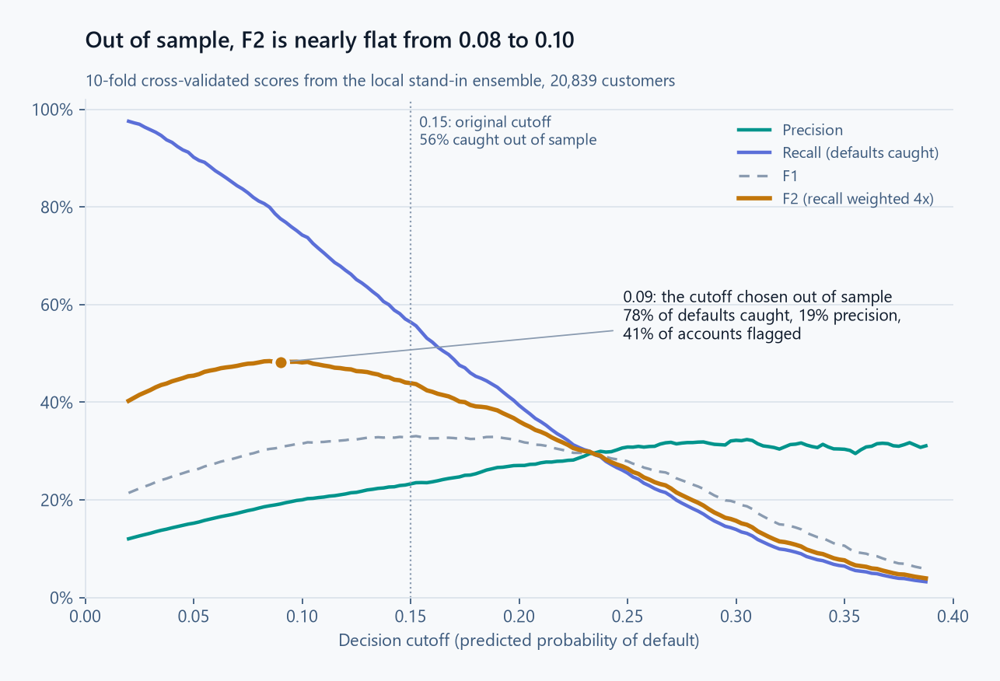

# Loan Default Prediction

A loan default model with ECOA-compliant features and a decision cutoff chosen for the business cost of a missed default, not for accuracy. Built with Azure AutoML, then rebuilt on Databricks with Optuna, MLflow and Unity Catalog, where one tuned LightGBM does the work of the three-model ensemble.

On a true 20% holdout the model catches about **80% of defaults (AUC 0.76)** at a cutoff of 0.09 chosen on the other 80%, flagging about 42% of accounts for review. The first analysis also reported 80% caught, at a cutoff of 0.15 that flags far fewer accounts, but that came from scoring the training data. On unseen customers that cutoff catches about 57%. Finding and correcting that is part of the write-up.

## Features and compliance

To support compliance with the Equal Credit Opportunity Act (ECOA), age and date of birth are left out of the champion model's features. In the Databricks version the registered model's input schema has no date of birth, so age can't reach it by construction. Other changes: active financial obligations consolidated into `total_open_accounts`, a negative-dependents anomaly (`-1`) recoded to `0`, and column types aligned to the registered model's schema.

A random-forest baseline on these features ranks the two credit scores first, followed by credit utilization, debt-to-income and monthly income:

<picture>
  <source media="(prefers-color-scheme: dark)" srcset="images/Feature_Importance-dark.png">
  
</picture>

## Azure AutoML

The pipeline points AutoML at Azure Blob Storage through `MLTable`, so nothing is held in local memory.

*   **Metric:** `auc_weighted` with k-fold cross-validation on a roughly 90/10 class imbalance (30 folds for the no-age job).
*   **Guardrails:** a 120-minute timeout, 50 trials and a concurrency cap; an earlier exploratory job used 5-fold CV, 60 minutes and 15 trials.
*   **Champion:** a `VotingEnsemble` that beat standalone XGBoost and LightGBM, registered in MLflow.

## Choosing the cutoff

A missed charge-off (false negative) costs more than a proactive account review (false positive), so the cutoff maximizes F2, which weighs recall four times as heavily as precision.

The original analysis set the cutoff at 0.15 from a precision/recall curve computed on the training data. The challenge's test set has no labels, so that curve scored the rows the model was trained on, which overstates performance. [validate_locally.py](notebooks/validate_locally.py) rebuilds the no-age features and a comparable soft-voting ensemble (LightGBM + XGBoost + logistic regression) and measures it on customers the model has not seen. Default rate: 10.2% of 20,839 customers.

| Evaluation | Cutoff | Defaults caught | Precision | AUC |
|------------|--------|-----------------|-----------|-----|
| Training data (original method) | 0.15 | 79.6% | 32.5% | 0.90 |
| 10-fold cross-validation | 0.15 | 56.4% | 23.3% | 0.76 |
| Held-out 20%, original cutoff | 0.15 | 57.7% | 22.9% | 0.76 |
| **Held-out 20%, cutoff chosen on the other 80%** | **0.09** | **80.0%** | **19.3%** | **0.76** |

<picture>
  <source media="(prefers-color-scheme: dark)" srcset="images/Precision_recall_curve-dark.png">
  
</picture>

*   At the original 0.15 cutoff, the model catches about 57% of defaults on unseen customers, not the 80% the training data showed.
*   Choosing the F2 cutoff properly, on separate data, lands at **0.09**: about **80% of defaults caught on a true holdout**, with roughly 42% of accounts flagged for review. Whether that review volume is acceptable is a business decision about the cost of a review against a charge-off.
*   Out-of-sample AUC is about **0.76**, solid and realistic for application-time credit data.
*   The table and chart come from the versions pinned in `requirements-dev.txt`. F2 is nearly flat between 0.08 and 0.10, so library versions move the cutoff: an earlier run on unpinned versions picked 0.10 and caught 74.6% at 19.8% precision. The chart uses the cross-validated scores for all 20,839 customers, so its figures at 0.09 differ slightly from the holdout row.

## What drives risk

SHAP (through a `KernelExplainer` wrapper) on the ensemble: lower monthly income and lower credit scores are the dominant upward drivers of default risk; credit utilization and debt-to-income move predictions far less. The AutoML model stays in the Azure ML workspace, so the chart repeats the notebook's SHAP setup (a 100-row background, 300 sampled customers) on the local stand-in ensemble; its top five drivers come out in the same order as the AutoML champion's.

<picture>
  <source media="(prefers-color-scheme: dark)" srcset="images/SHAP-dark.png">
  
</picture>

## Databricks version

The same model, rebuilt on Databricks Free Edition (serverless) in [databricks/](databricks/) as an Asset Bundle with one job, `loan-default-pipeline`:

| Step | Notebook | What it does |
|------|----------|--------------|
| Load | `01_load_data.py` | Reads `train.csv` and `test.csv` from a Unity Catalog volume into the Delta tables `workspace.loans.raw_train` and `raw_test` |
| Tune and train | `02_tune_train.py` | Optuna search, one look at the holdout, and the model registered in Unity Catalog |
| Score | `03_score.py` | The champion model scores the 1,000 test customers into `workspace.loans.predictions` |

**What changed from the Azure version**
*   **Tuning:** Optuna searches LightGBM settings (trees, learning rate, leaves, minimum leaf size, row and column sampling, L2 penalty) by 5-fold cross-validated AUC, in place of AutoML's model search. Its default sampler (TPE) learns from earlier trials which settings score well, and trials that trail the median after a fold or two are stopped early. Every trial is a nested MLflow run.
*   **The holdout stays out of tuning:** the search and the F2 cutoff use only the 80% development split. The 20% holdout, the same customers as above, is scored once at the end.
*   **Champion and challenger:** each run registers `workspace.loans.loan_default` as `@challenger`. It becomes `@champion` only if it beats the current champion's holdout AUC on the same customers, with a paired bootstrap interval above zero. Each run's holdout predictions are kept in `workspace.loans.holdout_predictions` for that comparison.
*   **One copy of the code:** the features, the stand-in ensemble and the cutoff search live in `databricks/src/loan_lib/`, which `validate_locally.py` imports too.

**Holdout results (4,168 customers)**

| Model | AUC | PR-AUC | Cutoff | Defaults caught | Precision | Accounts flagged |
|-------|-----|--------|--------|-----------------|-----------|------------------|
| Stand-in for the AutoML ensemble (three models) | 0.762 | 0.252 | 0.09 | 80.0% | 19.3% | 42.4% |
| Optuna-tuned LightGBM (one model) | 0.771 | 0.251 | 0.09 | 79.3% | 19.3% | 41.9% |

Tuned minus stand-in, paired bootstrap: AUC **+0.010** (95% interval +0.003 to +0.016); PR-AUC −0.001 (−0.017 to +0.012).
*   **The test:** both models score the same customers, so the comparison resamples customers 2,000 times and scores both models on each resample. That keeps the pairing and separates the models' difference from the luck of which customers landed in the holdout.
*   **Plain meaning:** the single tuned model ranks customers slightly but reliably better, since the AUC interval stays above zero. On precision-recall, which weighs the rare defaults most, the two can't be told apart, and at the business cutoff they flag and catch nearly the same accounts. One tuned model does the job of the three-model ensemble.
*   **Assumptions:** customers are independent of one another, and the holdout resembles future applicants. The interval is the 2.5th to 97.5th percentile of the resampled differences.

The search settled on small trees (7 leaves, 250 trees, learning rate 0.016). The drivers match the Azure SHAP analysis: monthly income (41% of the mean absolute SHAP value) and the two credit scores (28% and 27%) carry almost everything, and utilization, debt-to-income and the account counts together add about 5%.

## Run it

Local checks: `python -m pip install -r requirements-dev.txt`, then `python -m pytest -q tests`.

The workspace host comes from the CLI profile, so log in once first:

```
databricks auth login --host <your workspace URL> --profile free

# Once: the schema, the volume and the challenge files (not in this repo)
databricks schemas create loans workspace --profile free
databricks volumes create workspace loans raw_files MANAGED --profile free
databricks fs cp train.csv dbfs:/Volumes/workspace/loans/raw_files/train.csv --profile free
databricks fs cp test.csv dbfs:/Volumes/workspace/loans/raw_files/test.csv --profile free

cd databricks
databricks bundle deploy --profile free
databricks bundle run loan_default_pipeline --profile free
```

## Layout

*   `notebooks/Notebook.ipynb`: feature engineering, Azure AutoML orchestration, scoring, threshold analysis and SHAP.
*   `notebooks/validate_locally.py`: out-of-sample validation of the model and cutoff (runs locally, no Azure needed).
*   `notebooks/make_charts.py`: draws the charts in `images/` from the challenge's `train.csv`, in light and dark versions.
*   `databricks/`: the Databricks version as an Asset Bundle: three notebooks in `src/`, the job in `resources/`, and `src/loan_lib/`, the features, models, tuning and evaluation code that `validate_locally.py` also imports.
*   `tests/`: unit tests for `loan_lib` on synthetic applicants.

Stack: Azure Machine Learning SDK v2 and AutoML; Databricks (Unity Catalog, Delta, Jobs, Asset Bundles), MLflow, Optuna; Python, pandas, NumPy, scikit-learn, LightGBM, XGBoost; SHAP, Matplotlib, Seaborn.

## License

MIT ([LICENSE](LICENSE)). The challenge's `train.csv` and `test.csv` aren't in this repo.
